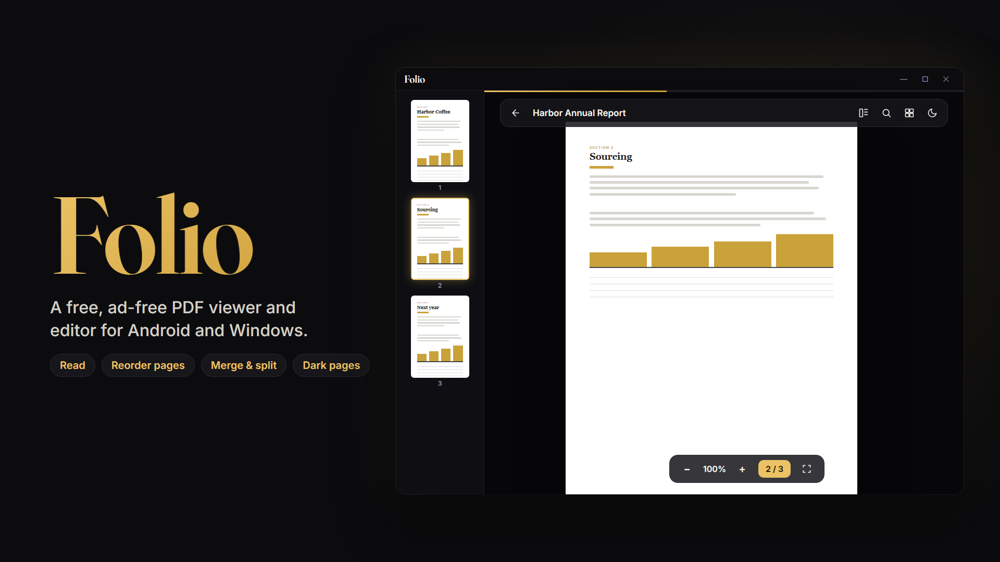
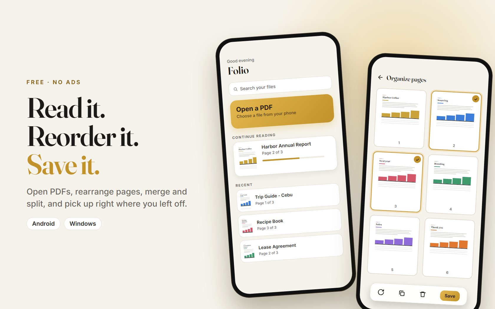

# Folio PDF

**A free, ad-free PDF viewer and editor for Android and Windows.**

## About

Folio PDF opens your PDFs, lets you read them comfortably, and lets you rearrange, merge and split their pages. It is free, with no ads and no account.

It remembers the page you stopped on, so you can pick up right where you left off.

*The images above are illustrations of the app, not screenshots.*

## Features

**Reading**
- Open PDFs with the file picker, including password-protected files. On Windows you can also drag a PDF onto the window.
- Smooth scrolling, pinch or scroll zoom, zoom buttons, **fit width** and **fit page**
- **Page thumbnails:** a side panel on wide screens, and a slide-out drawer on phones
- **Find in document** with a match count and next and previous buttons
- **Page style:** Normal, Sepia or Dark pages for night reading, remembered between sessions
- **Recent files** with real first-page covers and progress, and a **Continue reading** card that reopens the page you left off
- Light, dark or system theme with a warm gold accent

**Editing pages**
- **Organize pages:** drag to reorder (press and hold on phones), move to start or end, rotate, delete, duplicate, and undo
- **Merge:** use **Add PDF** to append pages from one or more other PDFs
- **Split and extract:** select pages and save them as a new PDF
- **Save** and **Save as**, with a warning if you leave with unsaved changes
- On Android, Save keeps the edited copy inside Folio, and **Export** opens the share sheet so you can send it to Files, Drive or a chat app

**Windows extras**
- A title bar that matches the theme
- Keyboard shortcuts: `Ctrl+F` find, `Enter` and `Shift+Enter` next and previous match, `Esc` close find, `Ctrl+` and `Ctrl-` zoom, `Ctrl+0` fit width, `Ctrl+G` go to page, `Ctrl+S` save and `Ctrl+Shift+S` save as

## Getting started

1. Go to the [Releases page](https://github.com/direkjames/Folio-PDF/releases/latest) and download the file for your device.
   - **Windows:** `FolioPDF-Setup`. If Windows shows a SmartScreen warning because the app is not code-signed, click **More info**, then **Run anyway**.
   - **Android:** the `.apk` file. Open it and allow installs from the app you opened it with.
2. Open Folio PDF and choose a PDF.
3. Press the grid button in the viewer to organize pages, and **Save** when you are done.

## Requirements

- Windows 10 or 11 (64-bit), or an Android phone

## Built with

- [Flutter](https://flutter.dev)
- [pdfrx](https://pub.dev/packages/pdfrx) and PDFium (MIT license) for showing and editing PDFs
- Inter and Fraunces fonts (SIL Open Font License 1.1)

Want to build it yourself? See [Developing Folio PDF](docs/DEVELOPING.md).

## Status

Active.

## Credits / License

Made by [direkjames](https://github.com/direkjames). See [LICENSE](LICENSE).
